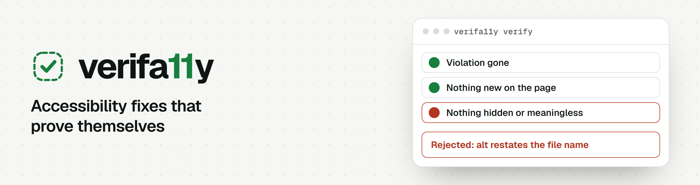
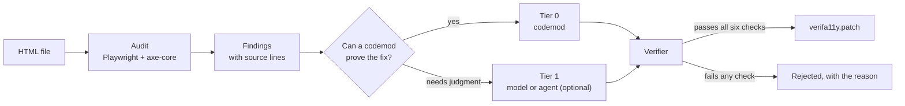

<h1 align="center">
  <picture>
    <source media="(prefers-color-scheme: dark)" srcset="docs/assets/banner-dark.png">
    
  </picture>
</h1>

<p align="center">
  An open-source <b>HTML accessibility checker that also writes the fix</b>, then re-checks it in a real browser
  and keeps only the patches that hold.
</p>

<p align="center">
  <a href="https://github.com/mateogsilvaa/verifa11y/actions/workflows/ci.yml"></a>
  <a href="https://www.npmjs.com/package/verifa11y"></a>
  <a href="LICENSE"></a>
  
  
  
  
</p>

<p align="center">
  <a href="https://mateogsilvaa.github.io/verifa11y/">Website</a> ·
  <a href="#quick-start">Quick start</a> ·
  <a href="#how-it-works">How it works</a> ·
  <a href="#use-it-where-you-work">MCP and GitHub Action</a> ·
  <a href="#results">Results</a> ·
  <a href="docs/README.md">Docs</a>
</p>

<p align="center">
  
</p>

## The problem

Accessibility tools hand you a report with hundreds of violations. Coding agents go further and write the fixes, then
confirm them by running the checker again. That check passes for the wrong reason more often than you would expect:
hide the element, paste the file name into the alt text, or add `aria-label="first"`, and axe reports nothing while the
page stays just as broken.

verifa11y checks the fix itself. It applies each patch to a copy of your page, loads the copy in Chromium and keeps
the patch only if the violation is gone, nothing new broke, and nothing was hidden or faked. You get a `.patch` file
you can `git apply`, and a report that says what it fixed, what it rejected and why.

```json
{
  "findingId": "f_0005",
  "ruleGone": true,
  "newViolations": [],
  "suspicious": true,
  "reason": "text alternative \"plot map\" only restates the file name \"plot-map.png\"",
  "status": "rejected_suspicious"
}
```

axe is satisfied by that patch (`ruleGone: true`, nothing new). verifa11y rejects it anyway and says why.

> **Scope.** verifa11y patches **static HTML files**. It can also crawl a live site and report on it, but a live page
> has no source file to patch. It does **not** guarantee WCAG conformance: "verified" means the checks found the
> violation gone and nothing else worse. A person still reviews every patch.
>
> **No telemetry, no account, no server.** The only network traffic is the page you audit and, if you configure
> one, the model or agent that writes the harder fixes.

## Quick start

Requires Node.js 20 or later.

```sh
npx verifa11y install-browser                           # once: the headless Chromium it renders with
npx verifa11y audit page.html --out findings.json       # every violation, with rule, WCAG criterion and source lines
npx verifa11y fix findings.json --verify --strict --out patches
git apply patches/verifa11y.patch                       # after you have read the diff
```

No model is needed. Codemods fix what can be proven from the markup and the rest is reported as skipped, with the
reason. To let a model or an AI agent attempt alt text, contrast and widget state, add `--generator-cmd` (see
[Use it where you work](#use-it-where-you-work)).

## What you get

| Step | What it does |
|---|---|
| **Find** | Audits with Playwright and axe-core, and maps every violation to exact source lines. |
| **Fix** | Deterministic codemods for what can be proven. Optionally any model or agent CLI for what needs judgment. |
| **Verify** | Six checks on every patch, whoever wrote it (below). A fix that fails any of them is thrown out. |
| **Review** | A standard `.patch`, a per-finding JSON verdict and a report. Suspicious patches are listed for a person. |

## How it works



Every patch goes through the same six checks, including verifa11y's own codemods:

| # | Check | What it catches |
|---|---|---|
| 1 | **Gone** | axe-core still reports the violation on that element. |
| 2 | **Nothing new** | The patch broke a different WCAG 2.x A/AA rule anywhere on the page. |
| 3 | **Nothing faked** | Hidden elements, `aria-hidden`, `role="presentation"`, generic or file-name alt text, one-character labels. |
| 4 | **Accessibility tree** | An element lost its name, role, state or focusability, in Chromium's computed tree. |
| 5 | **Focus order** | Real Tab presses: an element left the tab order or the sequence changed. |
| 6 | **Pixels** | The page changed outside the patched elements, which a contrast "fix" that repaints everything does. |

Details: [how it works](docs/how-it-works.md) and [the verifier](docs/verifier.md). The test suite also generates
hundreds of deliberately fake fixes and fails if the verifier accepts a single one.

## Use it where you work

**Terminal and CI.** The commands above, or the [GitHub Action](docs/github-action.md), which reviews pull requests
and posts verified fixes as suggestions on the exact lines:

```yaml
- uses: actions/checkout@v4
  with:
    ref: ${{ github.event.pull_request.head.sha }}
- uses: actions/setup-node@v4
  with:
    node-version: 22
- uses: mateogsilvaa/verifa11y@v0.4.1
```

**Any AI agent, through MCP.** `verifa11y-mcp` gives Claude Code, Claude Desktop, Cursor, Windsurf, VS Code, Zed, Cline,
Gemini CLI, Codex, opencode, OpenClaw and any other MCP client four tools: `rules`, `audit`, `fix` and `verify`. The
agent writes the judgment fixes and verifa11y decides whether they hold. See [MCP server](docs/mcp.md) and the
[agent contract](docs/agents.md).

```sh
claude mcp add verifa11y -- npx -y verifa11y-mcp --root .
```

**Your own model, even offline.** Any command that reads a request on stdin and prints a patch works as tier 1:

```sh
npx verifa11y fix findings.json --verify --strict --generator-cmd "ollama run qwen3:8b --think=false"
npx verifa11y fix findings.json --verify --strict --generator-cmd "claude -p"
```

A weak model produces more rejected patches, never wrong ones in the output.

## Results

95 broken pages, 1,400 violations, every patch through the full verifier. 73 of the pages are a held-out set that
nobody tuned anything on. Precision is measured against the verifier, not against a person, with 95% Wilson intervals.

| Who writes the patches | Set | Verified | Precision vs the verifier |
|---|---|---:|---|
| verifa11y codemods (offline, no model) | held out | 18 of 18 | 100% [82.4–100] |
| | dev | 136 of 136 | 100% [97.3–100] |
| Naive quick fixes (a strawman, on purpose) | held out | 619 of 736 | 84.1% [81.3–86.6] |
| | dev | 403 of 653 | 61.7% [57.9–65.4] |
| A real model | | not measured yet | |

The naive fixer exists to measure the verifier. On the dev pages it wrote 653 patches. The verifier rejected 250 of
them, and re-running axe alone would have let 223 of those through. Across both sets, 238 patches pass axe and fail
the rest.

Read "verified" as an upper bound on quality: the verifier proves a patch made nothing worse, not that it is what the
author meant. The held-out codemod sample is 18 patches, so the interval is wide. Every number, every rule and every
caveat is in the [benchmark report](docs/benchmark.md).

## How it compares

| | Auditors (axe, Lighthouse) | A coding agent alone | verifa11y |
|---|---|---|---|
| Finds violations | Yes | If it runs an auditor | Yes, to the source line |
| Writes the fix | No | Yes | Yes |
| Re-checks the fix in a real browser | No | Re-runs the auditor, at best | Six checks |
| Rejects fixes that only silence the checker | No | No | Yes |
| Says why a fix was rejected | No | No | Yes |
| Hands you a patch to review | No | Edits your files directly | A `.patch` file |
| Works offline, no account | Yes | Depends on the agent | Yes |

## Limitations

- **Static HTML only.** Templates and JavaScript frameworks are not patched yet. Site mode audits rendered pages but
  never patches them.
- **Eight rules are patched:** `image-alt`, `label`, `heading-order`, `aria-roles`, `aria-required-attr`,
  `aria-allowed-attr`, `aria-valid-attr-value` and `color-contrast`. Everything else axe finds is used to detect
  regressions.
- **No automated check is a person.** An alt text can be specific and still wrong about what the image means. Review
  every patch before you merge it.

The full list is in [limitations](docs/limitations.md).

## Documentation

| Page | What it covers |
|---|---|
| [How it works](docs/how-it-works.md) | The pipeline, the two tiers, and plugging in any model or agent |
| [The verifier](docs/verifier.md) | The six checks in detail and the design decisions behind them |
| [Install and command line](docs/cli.md) | Every command and option, and installing from source |
| [MCP server](docs/mcp.md) · [Agent contract](docs/agents.md) | Using verifa11y as a tool, and what its results mean |
| [GitHub Action](docs/github-action.md) | Verified suggestions on pull requests |
| [Site mode](docs/site-mode.md) · [Sandbox](docs/sandbox.md) | Auditing a live site, and running it in a container |
| [Benchmark](docs/benchmark.md) | The corpus, every result and how to reproduce it |
| [Packages and the Rule API](docs/packages.md) · [Rule author guide](docs/rule-author-guide.md) | Embedding the engine and writing rules |
| [Architecture decisions](docs/adr) · [Roadmap](ROADMAP.md) · [Changelog](CHANGELOG.md) | Why it is built this way, and what comes next |

## Contributing

Contributions are welcome: a new codemod case, a rule proposal, a corpus page, a bug report. Start with
[CONTRIBUTING.md](CONTRIBUTING.md), and see [GOVERNANCE.md](GOVERNANCE.md) and the
[Code of Conduct](CODE_OF_CONDUCT.md). Two rules come before everything else: the verifier is never weakened to
improve a number, and tier 0 stays at 100% precision. Report security issues as described in
[SECURITY.md](SECURITY.md).

```sh
npm test               # builds, then runs every test with a real browser (includes both sabotage suites)
npm run bench:codemod  # required when you touch rules, the verifier or the pipeline
```

If verifa11y saves you review time, a star on this repository helps other people find it.

## License

Apache-2.0, see [LICENSE](LICENSE) and [NOTICE](NOTICE). Third-party corpus pages keep their own licenses (axe-core
fixtures: MPL-2.0; W3C BAD pages: W3C Software and Document License); see [corpus/README.md](corpus/README.md).
