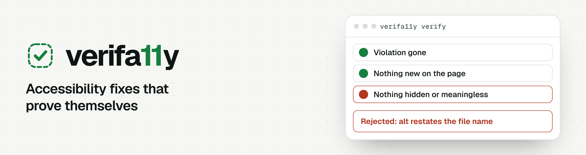

<p align="center"></p>

# verifa11y

**An HTML accessibility checker that also fixes what it finds, and keeps only the patches a verifier proves.** verifa11y audits a
page with axe-core, writes a minimal patch for each violation (deterministic codemods; a model or any agent CLI only
where judgment is needed), applies it to a copy, and re-checks the page: axe with every WCAG 2.x A/AA rule, the
browser's accessibility tree, the keyboard focus order and the rendered pixels. What survives is a standard
`.patch` you can `git apply`.

> **Not a conformance audit.** "Verified" means the automatic checks found the violation gone and nothing else
> worse. It is not a human review, and verifa11y does not make a page "accessible". No telemetry, no account.

```sh
npx verifa11y install-browser          # once: the headless Chromium it renders with
npx verifa11y audit page.html --out findings.json
npx verifa11y fix findings.json --verify --strict --out patches
git apply patches/verifa11y.patch
```

Without a model configured, only the fixes that can be computed from the markup are attempted (tier 0); the rest are
reported as skipped, with the reason. `--generator-cmd` plugs in any model or agent CLI for tier 1, and every one of
its patches goes through the same verifier.

Other commands: `verify` (one patch), `site` (crawl and audit a live site; reports only), `bench`.

- Documentation: [README](https://github.com/mateogsilvaa/verifa11y#readme), [how it works](https://github.com/mateogsilvaa/verifa11y/blob/main/docs/how-it-works.md), [the verifier](https://github.com/mateogsilvaa/verifa11y/blob/main/docs/verifier.md)
- Benchmark, including the uncomfortable numbers: [benchmark](https://github.com/mateogsilvaa/verifa11y/blob/main/docs/benchmark.md) and [limitations](https://github.com/mateogsilvaa/verifa11y/blob/main/docs/limitations.md)
- For AI agents: [AGENTS.md](https://github.com/mateogsilvaa/verifa11y/blob/main/AGENTS.md), and the MCP server [`verifa11y-mcp`](https://www.npmjs.com/package/verifa11y-mcp)
- GitHub Action: [docs/github-action.md](https://github.com/mateogsilvaa/verifa11y/blob/main/docs/github-action.md)

Node.js 20 or later. Version 0.x: the Rule API is experimental. Apache-2.0.
